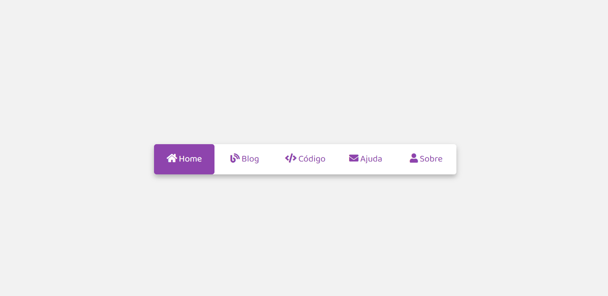

# 🧭 Animação Barra de Navegação

Projeto de uma barra de navegação interativa, desenvolvido com **HTML5 e CSS3** como parte de uma atividade prática do curso PROA.

O projeto tem como objetivo explorar conceitos de interatividade utilizando CSS, estilização de menus e criação de animações, permitindo alternar entre diferentes opções de navegação por meio de um indicador deslizante.

## 🖥️ Prévia do projeto

  

🔗 **[Acesse o projeto online](https://gabrielc0liveira.github.io/Projeto4Proa-AnimacaoBarradeNavegacao/)**

## Funcionalidades e características

- Barra de navegação horizontal com cinco opções: Home, Blog, Código, Ajuda e Sobre.
- Indicador roxo que desliza entre os itens selecionados.
- Animação de transição suave utilizando `cubic-bezier()`.
- Alteração automática da cor do texto e dos ícones conforme a seleção.
- Efeitos visuais ao passar o mouse sobre os itens.
- Interatividade implementada inteiramente com HTML e CSS, sem JavaScript.

## Tecnologias utilizadas

- **HTML5:** estruturação dos elementos de navegação e utilização de inputs do tipo radio.
- **CSS3:** estilização, posicionamento, animações e controle visual dos itens selecionados.
- **Font Awesome:** utilização de ícones nos elementos da barra de navegação.
- **Google Fonts:** utilização da fonte Baloo 2.

## Aprendizados

Durante o desenvolvimento, foram praticados conceitos como:

- Estruturação de menus de navegação utilizando HTML.
- Organização e alinhamento de elementos com Flexbox.
- Utilização de inputs do tipo `radio` para controlar estados de seleção.
- Aplicação dos seletores CSS `:checked` e `~` para criar interatividade sem JavaScript.
- Criação de animações utilizando `transition` e `cubic-bezier()`.
- Manipulação de posicionamento e cores conforme a interação do usuário.

## 📂 Como executar o projeto

🔗 **[Acesse o projeto online](https://gabrielc0liveira.github.io/Projeto4Proa-AnimacaoBarradeNavegacao/)**

---

Desenvolvido por **Gabriel Oliveira** como parte das atividades práticas do PROA.
